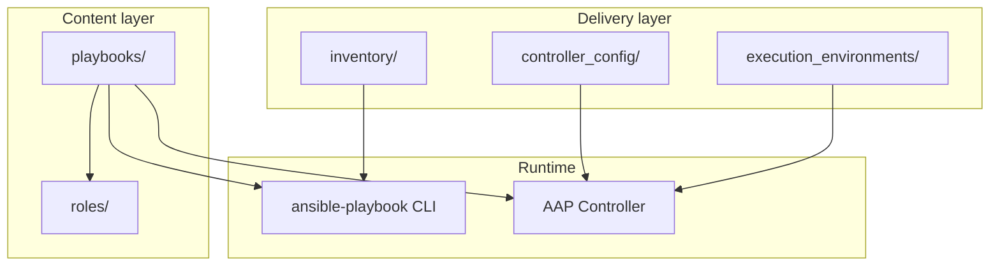

# Architecture

How the ACL ready-to-use content repository is organized and how it relates to
the legacy `ready-to-use-content` repo.

## Two-repo migration model

| Repository | Role |
|------------|------|
| `ready-to-use-content` | Legacy reference — numbered scenario folders, frozen baseline for diff |
| `acl-ready-to-use-content` | Migration target — ACL layout, all structural migration happens here |

Content is **copied** from legacy to ACL (not renamed in place). The pilot batch
validates layout and role path resolution before bulk migration continues.

## Repository layout

```
acl-ready-to-use-content/
├── playbooks/<slug>/       # Thin entry-point playbooks per scenario
├── roles/                  # All roles hoisted to repo root
├── collections/
│   └── requirements.yml    # CLI / lint collection install
├── execution_environments/ # EE build manifest (ansible-builder)
├── controller_config/      # AAP Configuration as Code (CaC)
├── inventory/              # Example inventory + group_vars (→ inventories/ later)
├── docs/                   # Cross-cutting guides
└── ansible.cfg             # roles_path = roles
```



## Role hoisting

Legacy scenarios kept roles inside `<NN>_scenario/roles/`. The ACL repo hoists
all roles to top-level `roles/` and discovers them via `ansible.cfg`:

```ini
[defaults]
roles_path = roles
```

Playbooks were copied verbatim (thin `roles:` lists). The pilot does **not**
apply issue #25 role consolidation — that is future Step 5 / follow-on work.

## Configuration layers (GPA-aligned)

| Layer | Location | Purpose |
|-------|----------|---------|
| Playbook `vars:` | `playbooks/<slug>/` | Scenario-specific constants (e.g. `report_namespace`) |
| Inventory | `inventory/`, `playbooks/<slug>/group_vars/` | Operator toggles, site config |
| Role defaults | `roles/<name>/defaults/` | Sensible defaults, prefixed per GPA |
| Surveys / extra vars | AAP job template | Runtime overrides (highest priority for operators) |

Reporting follows [reporting-standard.md](reporting-standard.md).

## Configuration as Code (`controller_config/`)

`controller_config/` holds YAML consumed by `infra.controller_configuration` to
provision AAP objects (projects, job templates). It ships **with** the content
so job template playbook paths stay in sync with migrated playbooks.

Pilot job templates are defined in `controller_config/job_templates.yml`.
Placeholder org/inventory/credential names must be replaced per site.

## Execution environments

`execution_environments/` defines the ansible-builder manifest. The EE
requirements mirror `collections/requirements.yml` and add
`rhel-system-roles.network` for the DHCP client playbook.

## Standards alignment

| Source | Governs |
|--------|---------|
| ACL spec | Repo categories, CaC delivery model |
| [GPA](https://redhat-cop.github.io/automation-good-practices/) | Role design, thin playbooks, inventory |
| Issue #25 | Detailed target tree and consolidation map (future) |

**Starter-pack decision:** roles stay as standalone in-repo roles (not packaged
as a collection) for AAP debuggability.

## Planned changes (not yet done)

- Rename `inventory/` → `inventories/` per ACL spec (deferred until playbook
  `vars_files` paths are updated — e.g. network fault diagnosis)
- Remaining scenario migration (Step 2) and static → role conversion (Step 5)
- Functional backlog fixes (Step 3) after Steps 1 and 2 complete

## Pilot batch status

**In ACL repo:** docs 101–103 (`docs/vmware/`); playbooks 10, 11, 12, 15, 16,
302 with 18 hoisted roles. Awaiting lab validation before the next move batch.
