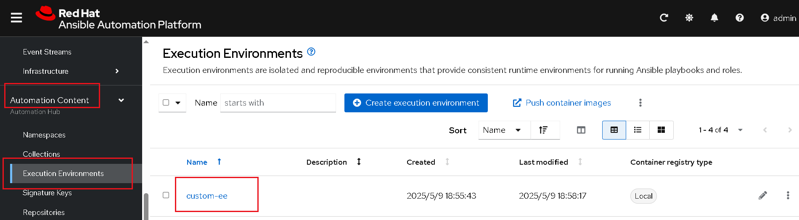
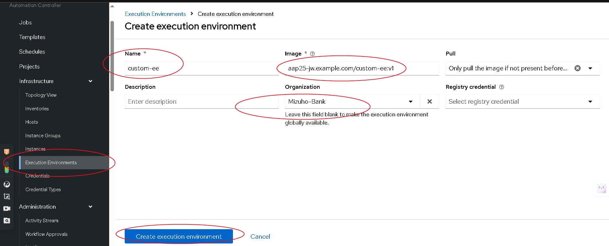

*Why customize the Execution Environment (EE)?*

Running any playbook in Ansible requires a local system Python environment, including the correct Python version, Python dependencies, and relevant library files. As Ansible supports an increasing number of automation objects, different objects will have different dependencies. This means a single Python environment cannot meet the requirements of different objects. Therefore, Ansible needs to prepare specific Python runtime environments for different automation objects. The method used is to customize or package these Python runtime environments into different container images. This is called an Execution Environment (EE).

Therefore, EEs provide a convenient and flexible way to customize Python runtime environments for different automation objects, reducing the workload and difficulty of Ansible development and maintenance. A typical scenario is when using Ansible to call VMware vCenter collections or APIs to achieve automation; the first step is to build an EE for different vCenter versions.

Therefore, the following content describes the process of building an EE for VMware vCenter, which is a necessary and primary step for integrating Ansible with VMware vCenter.

*The basic environment for building the Execution Environment (EE)：*

[width="100%",cols="46%,22%,17%,15%",]
|===
|Role |Hostname |IP |Comment
|AAP Controller 2.5 on RHEL 9.5 |aap25-jw.example.com |10.66.208.239 |
|VMware vCenter 7.2{plus} | |10.71.18.138 |
|===

*Steps for building an Execution Environment (EE)：*

[arabic]
. *Choose which default EE to build your custom EE on：*
+
Access the AAP interface, and you can find it under "Infrastructure" --++>++ "Execution Environment".
+
Select the most commonly used standard image, and you can see the full link to the image after clicking to enter:image:extracted-media/media/image1.png[extracted-media/media/image1,width=642,height=184]

The following steps will use this EE to build a custom EE for the vCenter environment.

[arabic, start=2]
. *Download the base EE to your local machine：*
+
Switch to the AAP Controller command-line interface, log in to the Hub container image repository (using the hub image repository password specified when installing AAP), and download the image.：

++[++admin@aap25-jw ~++]++$ podman login aap25-jw.example.com

username: admin

password:

Login Successfully

++[++admin@aap25-jw ~++]++$ podman pull aap25-jw.example.com/ee-supported-rhel8:latest

++[++admin@aap25-jw ~++]++$ podman images ++|++ grep aap25

aap25-jw.example.com/ee-supported-rhel8 latest 2b89470e3b40 5 weeks ago 2.26 GB

Note：

* The user performing the above operations is the username and password specified in the configuration file during AAP installation for logging into the container registry. In most cases, the installation and deployment will use the admin user and their password.
* The image you see, ee-supported-rhel8:latest, is the standard EE image. We will use this image as the base image to build our custom image.
* This image can also be obtained from regitry.redhat.io, Red Hat's official container image repository, but using a local image will be faster during the image build process.

[arabic, start=3]
. *Download and install ansible-navigator：*
+
Ansible-navigator is used to manage EEs and execute playbooks, while also providing the ansible-builder tool for building custom EEs.
+
If the AAP installation package used is an RPM setup bundle, it can be obtained directly from the bundle;
+
If the AAP installation package used is a container setup bundle, it needs to be downloaded from Red Hat RHN.

++[++admin@aap25-jw ~++]++$ yum install ansible-navigator

*4，Create a project directory for building your EE：*

++[++admin@aap25-jw ~++]++$ mkdir aap/controller/data/projects/example-project/

++[++admin@aap25-jw example-project++]++$ mkdir ee-builder/

*5，Create the configuration files required to build EE (including execution-environment.yml, requirements.yml, requirements.txt, bindep.txt. If you want to embed the edited ansible.cfg into EE, you need to create context/files/ansible.cfg according to the configuration in execution-environment.yml)：*

++[++admin@aap25-jw ee-builder++]++$ cat execution-environment.yml

---

version: 3

dependencies:

galaxy: requirements.yml

python: requirements.txt

system: bindep.txt

images:

base++_++image:

name: registry.redhat.io/ansible-automation-platform-25/ee-supported-rhel8:latest

additional++_++build++_++files:

- src: files/ansible.cfg

dest: configs

++[++admin@aap25-jw ee-builder++]++$ cat requirements.yml

---

collections:

- name: community.vmware

- name: vmware.vmware

- name: vmware.vmware++_++rest

- name: community.general

- name: community.crypto

- name: ansible.posix

- name: ansible.windows

- name: microsoft.ad

- name: chocolatey.chocolatey

- name: cloud.common

++[++admin@aap25-jw ee-builder++]++$ cat requirements.txt

git{plus}https://github.com/vmware/vsphere-automation-sdk-python.git

setuptools==70.3.0

pyVmomi++>++=8.0.3.0.1

vmware-vcenter

vmware-vapi-common-client

aiohttp

pywinrm

six

psutil

++[++admin@aap25-jw ee-builder++]++$ cat bindep.txt

python3.11-pip ++[++platform:rhel++]++

python3.11-devel ++[++platform:rhel++]++

python3-systemd ++[++platform:rhel++]++

gcc ++[++platform:rhel++]++

systemd-libs ++[++platform:rhel++]++

systemd-devel ++[++platform:rhel++]++

pkgconf ++[++platform:rhel++]++

++[++admin@aap25-jw ee-builder++]++$ cat context/files/ansible.cfg

++[++defaults++]++

collections++_++path = ./collections

inventory = ./inventory

log++_++path = ./aap++_++install.log

[arabic, start=6]
. *Build your EE：*
+
Execute the following command to build EE:

++[++admin@aap25-jw ee-builder++]++$ ansible-builder build -t aap25-jw.example.com/custom-ee:v1 -v3

Execute the following command to view the created EE：

++[++admin@aap25-jw ee-builder++]++$ podman images

REPOSITORY TAG IMAGE ID CREATED SIZE

aap25-jw.example.com/custom-ee v1 d10aa579a893 1 minute ago 2.79 GB

......

*7. Push the built EE to AAP Local Automation Hub:*

++[++admin@aap25-jw ~++]++$ podman push aap25-jw.example.com/custom-ee:v1

*8，Log in to the AAP UI and confirm that the EE has been successfully uploaded in Local Automation Hub:*

*9，Create a new image in the AAP Infrastructure interface and associate it with the image you just pushed to the Hub:*

*10，If you need to directly call vCenter-related functions through the collection in the AAP Controller cmd, you need to install the required Python environment, dependencies, and related library files separately. The specific steps are as follows (optional)：*

++[++admin@aap25-jw example-project++]++$ sudo yum install python3-pip

++[++admin@aap25-jw example-project++]++$ pip3 install pyvmomi

++[++admin@aap25-jw example-project++]++$ pip3 install --upgrade pyvmomi

++[++admin@aap25-jw example-project++]++$ pip3 install setuptools==70.3.0

++[++admin@aap25-jw example-project++]++$ pip3 install --upgrade ++\++

git{plus}https://github.com/vmware/vsphere-automation-sdk-python.git

++[++admin@aap25-jw example-project++]++$ ansible-galaxy collection install community.general -p collections/

++[++admin@aap25-jw example-project++]++$ ansible-galaxy collection install community.vmware -p collections/

++[++admin@aap25-jw example-project++]++$ ansible-galaxy collection list -p collections/

# /home/admin/aap/controller/data/example-project/collections/ansible++_++collections

Collection Version

----------------- -------

community.general 10.6.0

community.vmware 5.6.0

vmware.vmware 2.0.0

++[++admin@aap25-jw example-project++]++$ pip install ++\++

-r collections/ansible++_++collections/community/vmware/requirements.txt

++[++admin@aap25-jw example-project++]++$ pip3.11 install requests

++[++admin@aap25-jw example-project++]++$ sudo pip3.11 install pyvmomi

++[++admin@aap25-jw example-project++]++$ pip3.11 --version

++[++admin@aap25-jw example-project++]++$ sudo pip3.11 install requests
