*Ansible AAP integrates with VMware vCenter for VM provision automatically*

In this article, we will introduce the steps and playbooks/job templates for VM automatically provision by Ansible AAP and VMware integration.

We will design a automation workflow to performing operation below:

1, Automatically clone Linux(RHEL) vm from existing VM template on VMware.

2, Cloned VM auto power on and apply network setting as demand.

3, Apply security baseline on provisioned vm.

4, Email notify administrator when above job done.

*Prerequisites：*

[arabic]
. Ansible Automation Platform 2.5{plus} installed
. EE for VMware integration has been created
. VM template(RHEL 8.x) already existed on vmware esxi server with vmware-tools installed
. Admin or privileged user with username & password on VMware vCenter
. Email setting parameters is ready(including mail server, port, sender username & password and recipient list)
. Organization, Project has been created on AAP UI

*The environment for vm provision automatically：*

[width="100%",cols="46%,22%,17%,15%",]
|===
|Role |Hostname |IP |Comment
|AAP Controller 2.5 on RHEL 9.5 |aap25-jw.example.com |10.66.208.239 |
|VMware vCenter 7.0{plus} | |10.71.18.138 |
a|
A Linux(RHEL 8.10) vm template

with vmware-tools and perl installed

| | |
|===

*Preparation：*

[arabic]
. Check VM template on vmware, make sure vmware-tools and perl installed：
+
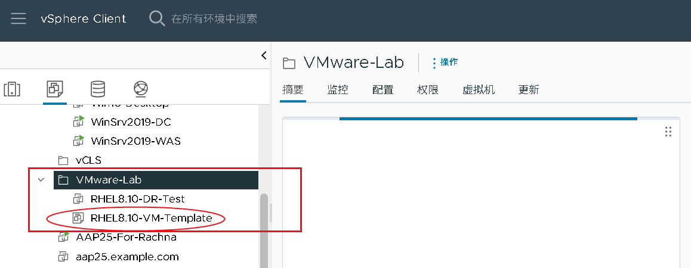
+
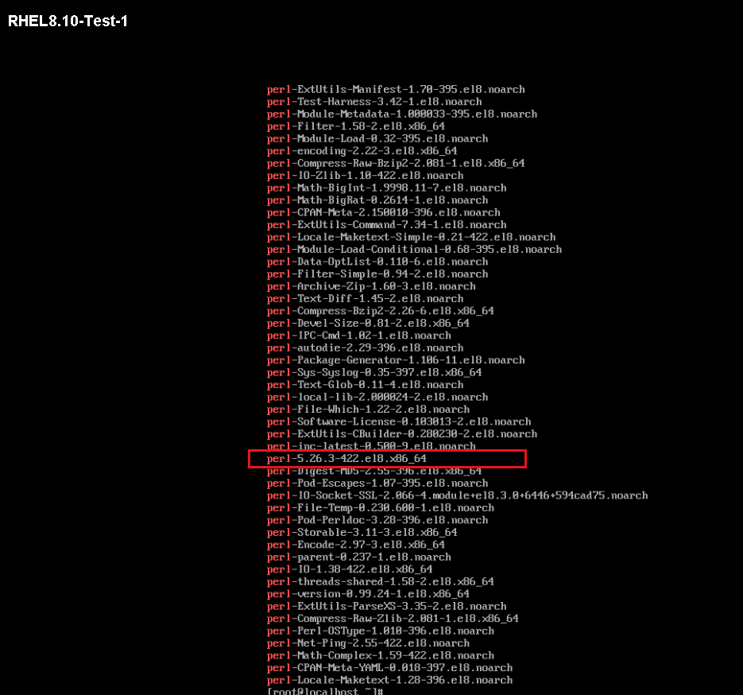
+
Note:
+
Below is the more detail information about my vm template:
+
Name: RHEL8.10-VM-Template
+
Location: in VMware folder “VMware++_++Lab”, and VMware datacenter “Beijing++_++dc02”
. Based on vCenter admin username and password create credential：
+
In my lab, vCenter IP is 10.71.18.138, admin username and password is：
+
administrator@vsphere.local
+
Your++_++password
+
So create a credential with name “vc++_++credential” and type “VMware vCenter” as following:
+
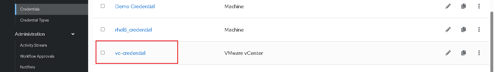
+
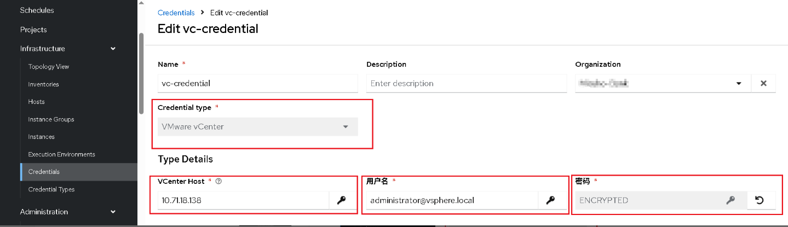
+
Since calling vCenter to execute VMware modules and collections is generally done on AAP, playbook tasks are usually executed locally on AAP via delegate++_++to: localhost or aap. Therefore, there is no need to create an inventory for VMware on the AAP UI.
. Ensure that the AAP controller's project directory contains a complete ansible.cfg file (encapsulated within a custom EE), an inventory file, and a complete collection (for local testing).

++[++admin@aap25-jw example-project++]++$ cat ansible.cfg

++[++defaults++]++

inventory = ./inventory

remote++_++user = admin

++[++privilege++_++escalation++]++

become = true

become++_++method = sudo

become++_++user = root

become++_++ask++_++pass = false

[arabic, start=4]
. Setup notifier on AAP：
+
Create a email notifier on AAP Web UI as example blow:
+
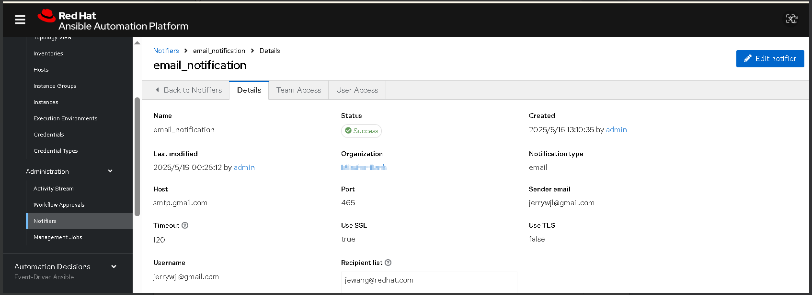

*Steps for create the Automation Workflow：*

[arabic]
. Create the first playbook, linux++_++vm++_++deploy.yml, content of playbook as below:

++[++admin@aap25-jw example-project++]++$ cat linux++_++vm++_++deploy.yml

---

- name: Deploy and configure RHEL VM on VMware

hosts: localhost

collections:

- community.vmware

vars:

vcenter++_++hostname: ""

vcenter++_++username: ""

vcenter++_++password: ""

data++_++center: ""

virtual++_++network: ""

vm++_++template: ""

vm++_++name: ""

vm++_++folder: ""

network++_++interface: ""

vm++_++ip: ""

vm++_++netmask: ""

vm++_++gateway: ""

vm++_++dns:

- ""

- ""

vm++_++root++_++password: cmVkaGF0 # base64 encoded password

tasks:

- name: Decode vcenter and virtual machine password

ansible.builtin.set++_++fact:

decoded++_++vcenter++_++password: "++{{++ vcenter++_++password ++|++ b64decode }}"

decoded++_++vm++_++root++_++password: "++{{++ vm++_++root++_++password ++|++ b64decode }}"

- name: Deploy VM from template

vmware++_++guest:

hostname: "++{{++ lookup('env', 'VMWARE++_++HOST') }}"

username: "++{{++ lookup('env', 'VMWARE++_++USER') }}"

password: "++{{++ lookup('env', 'VMWARE++_++PASSWORD') }}"

validate++_++certs: false

name: "++{{++ vm++_++name }}"

template: "++{{++ vm++_++template }}"

folder: "++{{++ vm++_++folder }}"

datacenter: "++{{++ data++_++center }}"

state: powered-on

networks:

- name: "++{{++ virtual++_++network }}"

ip: "++{{++ vm++_++ip }}"

netmask: "++{{++ vm++_++netmask }}"

gateway: "++{{++ vm++_++gateway }}"

dns++_++servers: "++{{++ vm++_++dns }}"

type: static

device++_++type: vmxnet3

connected: true

start++_++connected: true

wait++_++for++_++ip++_++address: true

wait++_++for++_++ip++_++address++_++timeout: 60

register: vm++_++deploy

- name: Wait until VMware Tools are running

community.vmware.vmware++_++guest++_++tools++_++wait:

hostname: "++{{++ lookup('env', 'VMWARE++_++HOST') }}"

username: "++{{++ lookup('env', 'VMWARE++_++USER') }}"

password: "++{{++ lookup('env', 'VMWARE++_++PASSWORD') }}"

validate++_++certs: false

datacenter: "++{{++ data++_++center }}"

name: "++{{++ vm++_++name }}"

folder: "++{{++ vm++_++folder }}"

timeout: 300

- name: Run command inside a virtual machine with wait and timeout

vmware++_++vm++_++shell:

hostname: "++{{++ lookup('env', 'VMWARE++_++HOST') }}"

username: "++{{++ lookup('env', 'VMWARE++_++USER') }}"

password: "++{{++ lookup('env', 'VMWARE++_++PASSWORD') }}"

validate++_++certs: false

datacenter: "++{{++ data++_++center }}"

folder: "++{{++ vm++_++folder }}"

vm++_++id: "++{{++ vm++_++name }}"

vm++_++username: root

vm++_++password: "++{{++ decoded++_++vm++_++root++_++password }}"

vm++_++shell: /usr/bin/nmcli

vm++_++shell++_++args: ++>++

connection modify ++{{++ network++_++interface }}

ipv4.addresses ++{{++ vm++_++ip }}/24

ipv4.gateway ++{{++ vm++_++gateway }}

ipv4.dns ++{{++ vm++_++dns ++|++ join(',') }}

ipv4.method manual

connection.autoconnect on

ipv6.method disabled

++>++ /tmp/set++_{{++ network++_++interface }}.txt 2++>++&1

wait++_++for++_++process: true

timeout: 300

register: shell++_++command++_++with++_++wait++_++timeout

- name: Apply and enable network

vmware++_++vm++_++shell:

hostname: "++{{++ lookup('env', 'VMWARE++_++HOST') }}"

username: "++{{++ lookup('env', 'VMWARE++_++USER') }}"

password: "++{{++ lookup('env', 'VMWARE++_++PASSWORD') }}"

validate++_++certs: false

datacenter: "++{{++ data++_++center }}"

folder: "++{{++ vm++_++folder }}"

vm++_++id: "++{{++ vm++_++name }}"

vm++_++username: root

vm++_++password: "++{{++ decoded++_++vm++_++root++_++password }}"

vm++_++shell: /usr/bin/nmcli

vm++_++shell++_++args: ++>++

connection up ++{{++ network++_++interface }}

++>++ /tmp/apply++_{{++ network++_++interface }}.txt 2++>++&1

wait++_++for++_++process: true

timeout: 60

register: apply++_++network

- name: Set vm++_++ip as a fact for workflow usage

ansible.builtin.set++_++stats:

data:

vm++_++ip: "++{{++ vm++_++ip }}"

per++_++host: false

- name: Add deployed VM to inventory

ansible.builtin.add++_++host:

name: "++{{++ vm++_++ip }}"

groups: provisioned

Create the first job template with name "T1 / Create++_++VMs++_++from++_++Template" base on the playbook as below:

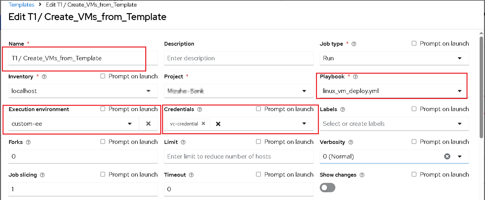

[arabic, start=2]
. Create the second playbook,linux++_++baseline++_++apply.yml, content of playbook as below:

++[++admin@aap25-jw example-project++]++$ cat linux++_++baseline++_++apply.yml

- name: Add dynamic host from previous playbook

hosts: localhost

gather++_++facts: false

tasks:

- name: Add VM to dynamic inventory

ansible.builtin.add++_++host:

name: "++{{++ vm++_++ip }}"

groups: provisioned

- name: Apply baseline configuration

hosts: provisioned

gather++_++facts: true

become: true

tasks:

- name: Ensure pwquality minimum length

lineinfile:

path: /etc/security/pwquality.conf

line: 'minlen = 14'

create: yes

- name: Set PASS++_++MAX++_++DAYS to 30

replace:

path: /etc/login.defs

regexp: '^PASS++_++MAX++_++DAYS++\++s{plus}++\++d{plus}'

replace: 'PASS++_++MAX++_++DAYS 30'

- name: Set PASS++_++MIN++_++DAYS to 1

replace:

path: /etc/login.defs

regexp: '^PASS++_++MIN++_++DAYS++\++s{plus}++\++d{plus}'

replace: 'PASS++_++MIN++_++DAYS 1'

- name: Update system-auth pwquality line

replace:

path: /etc/pam.d/system-auth

regexp: '^password++\++s{plus}requisite++\++s{plus}pam++_++pwquality++\++.so.++*++'

replace: 'password requisite pam++_++pwquality.so local++_++users++_++only'

- name: Add pwhistory to system-auth

lineinfile:

path: /etc/pam.d/system-auth

line: 'password requisite pam++_++pwhistory.so remember=13 use++_++authtok'

insertafter: '^password++\++s{plus}requisite++\++s{plus}pam++_++pwquality++\++.so.++*++'

- name: Update password-auth pwquality line

replace:

path: /etc/pam.d/password-auth

regexp: '^password++\++s{plus}requisite++\++s{plus}pam++_++pwquality++\++.so.++*++'

replace: 'password requisite pam++_++pwquality.so local++_++users++_++only'

- name: Add pwhistory to password-auth

lineinfile:

path: /etc/pam.d/password-auth

line: 'password requisite pam++_++pwhistory.so remember=13 use++_++authtok'

insertafter: '^password++\++s{plus}requisite++\++s{plus}pam++_++pwquality++\++.so.++*++'

- name: Set faillock deny = 3

replace:

path: /etc/security/faillock.conf

regexp: '^#?++\++s++*++deny++\++s++*++=.++*++'

replace: 'deny = 3'

- name: Force root to change password on next login

command: chage -d 0 root

- name: Set journald storage to persistent

replace:

path: /etc/systemd/journald.conf

regexp: '^#?Storage=.++*++'

replace: 'Storage=persistent'

- name: Restart systemd-journald

service:

name: systemd-journald

state: restarted

- name: Ensure authpriv logging is configured

lineinfile:

path: /etc/rsyslog.conf

regexp: '^authpriv++\++.++\*++'

line: 'authpriv.++*++ /var/log/secure'

- name: Ensure /var/log/secure exists with correct permissions

file:

path: /var/log/secure

state: touch

owner: root

group: root

mode: '0600'

- name: Ensure audit is installed

package:

name: audit

state: present

- name: Ensure auditd service is running and enabled

service:

name: auditd

state: started

enabled: yes

- name: Ensure /var/log/audit/audit.log exists

file:

path: /var/log/audit/audit.log

state: touch

owner: root

group: root

- name: Ensure /var/log/cron exists

file:

path: /var/log/cron

state: touch

owner: root

group: root

mode: '0600'

- name: Ensure /var/log/boot exists

file:

path: /var/log/boot

state: touch

owner: root

group: root

mode: '0600'

- name: Download and place yum repo file

get++_++url:

url: http://10.66.208.245/rhel810.repo

dest: /etc/yum.repos.d/rhel810.repo

- name: Validate yum repo

command: yum repolist

register: yum++_++output

changed++_++when: false

- name: Ensure chrony is installed and enabled

package:

name: chrony

state: present

- name: Ensure chronyd is running and enabled

service:

name: chronyd

state: started

enabled: yes

- name: Add cron job for secure log backup

cron:

name: Backup secure log

minute: 0

hour: 3

job: 'cp /var/log/secure /backup/secure.$(date {plus}++\++%Y++\++%m++\++%d)'

- name: Add cron job for messages log backup

cron:

name: Backup messages log

minute: 0

hour: 3

job: 'cp /var/log/messages /backup/messages.$(date {plus}++\++%Y++\++%m++\++%d)'

- name: Restart cron service

service:

name: crond

state: restarted

Create the second job template with name "T2 / Apply++_++baseline++_++for++_++provisioned" base on the playbook as below：

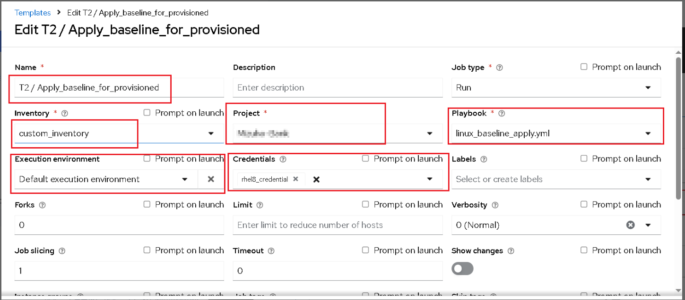

Note:

The inventory "custom++_++inventory" is actually an empty inventory, containing no hosts and serving only as a placeholder.

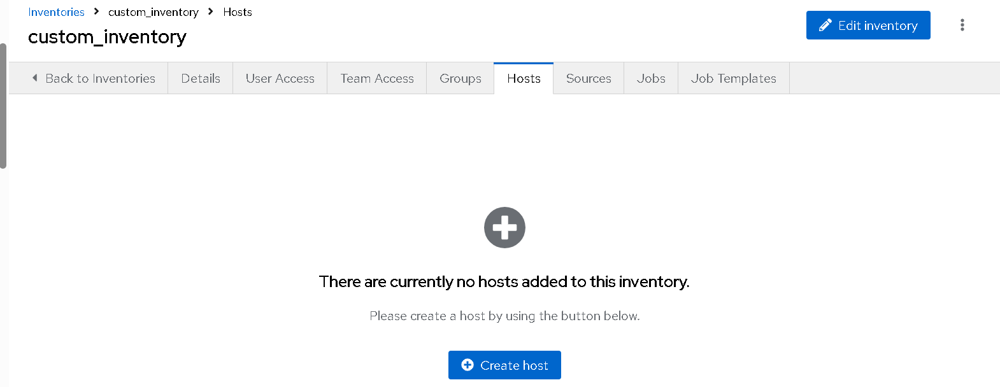

The credential “rhel++_++credential” is root password of the provisioned VM or vm template.

[arabic, start=3]
. Create the third playbook,linux++_++provision++_++notification.yml, content of playbook as below:

++[++admin@aap25-jw example-project++]++$ cat linux++_++provision++_++notification.yml

---

- name: Email Notification for VM provision result

hosts: localhost

vars:

data++_++center: ""

virtual++_++network: ""

vm++_++template: ""

vm++_++name: ""

vm++_++folder: ""

network++_++interface: ""

vm++_++ip: ""

vm++_++netmask: ""

vm++_++gateway: ""

vm++_++dns:

- ""

- ""

tasks:

- name: Send Email notification for provision result

delegate++_++to: localhost

community.general.mail:

host: smtp.gmail.com

port: 465

username: jerrywjl@gmail.com

password: YOUR++_++EMAIL++_++PASSWORD

to: jewang@redhat.com

subject: "VM Provision Complete Notification from Ansible Automation Platform"

body: ++|++

VM Provisioning Complete!

Details:

- Data Center : ++{{++ data++_++center }}

- Virtual Network : ++{{++ virtual++_++network }}

- VM Template : ++{{++ vm++_++template }}

- VM Name : ++{{++ vm++_++name }}

- VM Folder : ++{{++ vm++_++folder }}

- Network Interface : ++{{++ network++_++interface }}

- IP Address : ++{{++ vm++_++ip }}

- Netmask : ++{{++ vm++_++netmask }}

- Gateway : ++{{++ vm++_++gateway }}

- DNS Servers : ++{{++ vm++_++dns ++|++ join(', ') }}

This message was generated automatically by Ansible Automation Platform.

subtype: plain

Create the third job template with name "T3 / Provision++_++result++_++notification" base on the playbook as below：

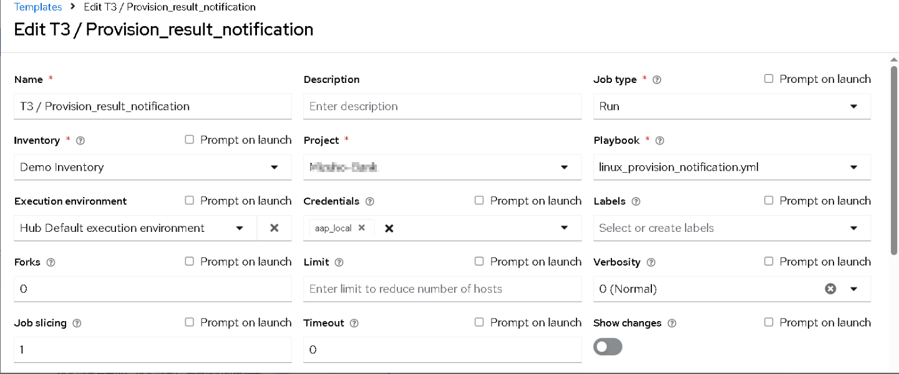

Note:

The inventory “Demo Inventory” is localhost, aap controller itself.

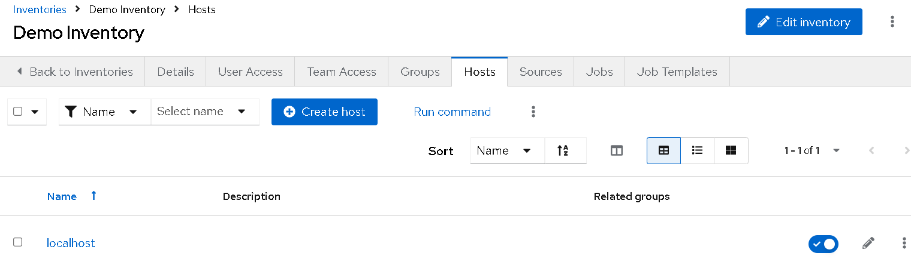

The credential “aap++_++local” is also localhost, aap controller itself.

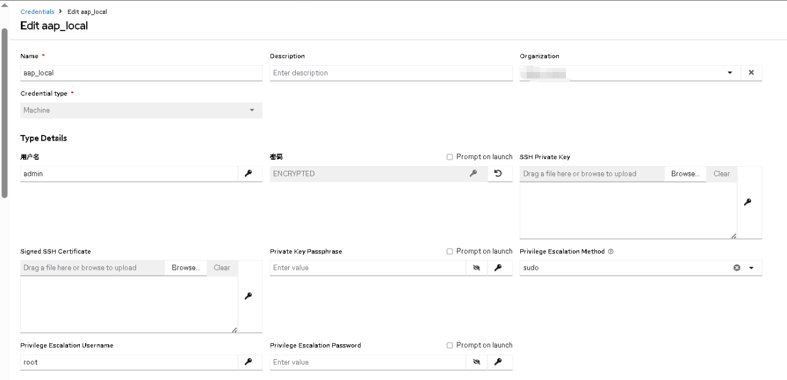

[arabic, start=4]
. Create the workflow job template with name “Linux++_++VM++_++Provision++_++with++_++Baseline++_++apply”, which is consisted of Job template T1-T3 we just created.
+
On AAP UI the process of workflow job template is as below:
+
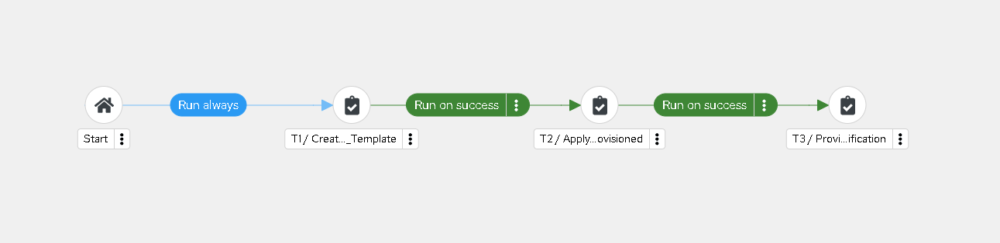

[arabic, start=5]
. Create a couple of survey on the workflow job template as below, based on my Lab env.
+
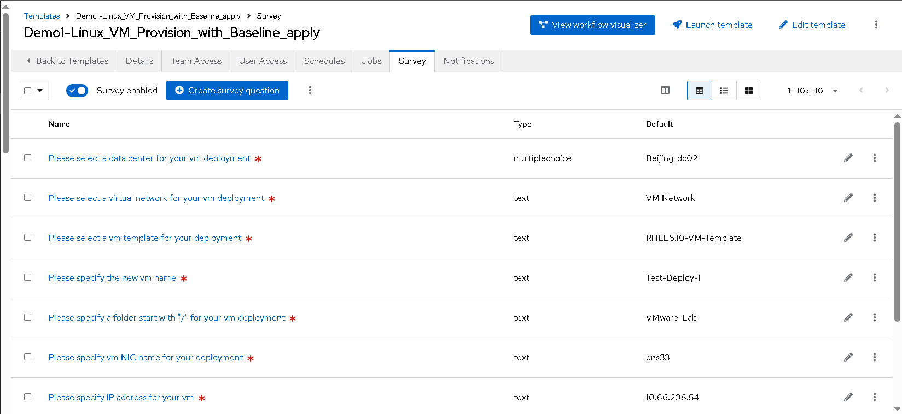
+
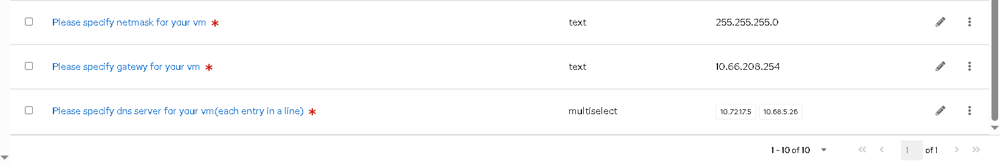
. When launch the workflow, you will need to input variables with survey above.
+
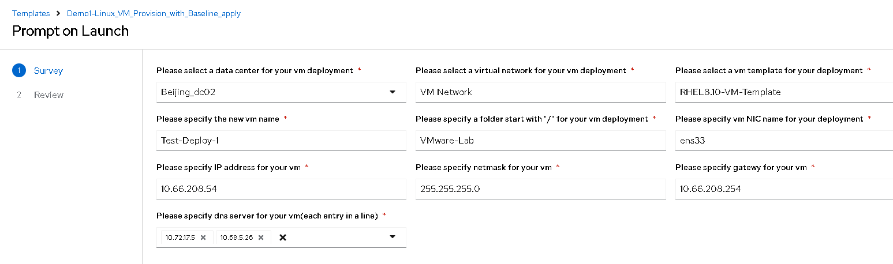
+
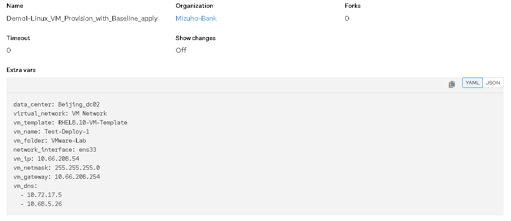
. Enable notifier on the workflow as below:
+
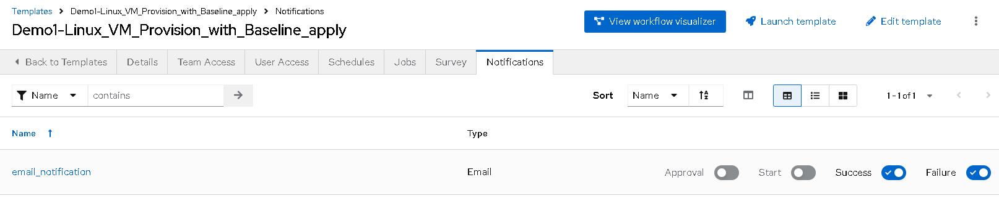
. After the workflow running successfully, you will get the email notification about the result like below:
+
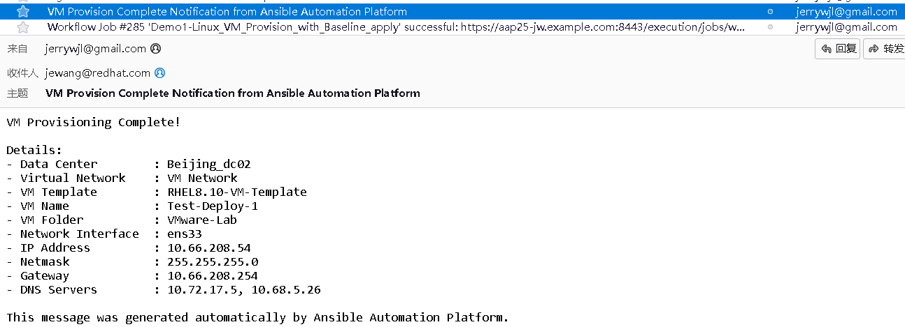
