*Ansible AAP integrates with VMware vCenter for VM DR between Data Centers*

In this article, we will introduce how to use Ansible AAP to unregister specified vm from primary VMware data center and register to target data center as DR site. This scenario is also used for vm disaster recovery.

We will design a automation workflow to performing operation below:

1, Check capacity of DR site data store.

2, Send result by email to notify admin and wait for approval.

3, Once get approval, automatically power off vm on primary data center.

4, Unregister vm from primary site data center and register to DR site data center.

5, Power on vm on DR site data center and assign new IP, gateway, dns as demand, then auto startup application(httpd).

6, Email notify admin if above done.

*Prerequisites：*

[arabic]
. Ansible Automation Platform 2.5{plus} installed
. EE for VMware integration has been created
. On VMware vCenter UI:
[arabic]
.. Primary site data center: “Beijing++_++dc02”
.. DR site data center: “Shenzhen++_++dc01” and a cluster with name “Cluster01” is under the data center
.. A vm with name “RHEL8.10-DR-Test”, which is in directory “VMware-Lab” and “Beijing++_++dc02”
. Theoretically, primary and DR site data center are using same data store which is usually shared storage, or primary and DR site data store can keep data sync all the time. For POC or testing purpose, we will copy vm config file(with .vmx suffix) and disk image file(with .vmdk suffix) of “RHEL8.10-DR-Test” to DR site data store for simulation.

*The environment for vm DR between data center：*

[width="100%",cols="49%,22%,17%,12%",]
|===
|Role |Hostname |IP |Comment
|AAP Controller 2.5 on RHEL 9.5 |aap25-jw.example.com |10.66.208.239 |
|VMware vCenter 7.0{plus} | |10.71.18.138 |
|Primary site data center “Beijing++_++dc02” | | |
|DR site data center “Shenzhen++_++dc01” | | |
|A Linux(RHEL 8.10) vm with name RHEL8.10-DR-Test | | |
|===

*Preparation：*

[arabic]
. Check VM “RHEL8.10-DR-Test” at first, it’s original running on primary site data center “Beijing++_++dc02”, under “VMware++_++Lab” directory.
+
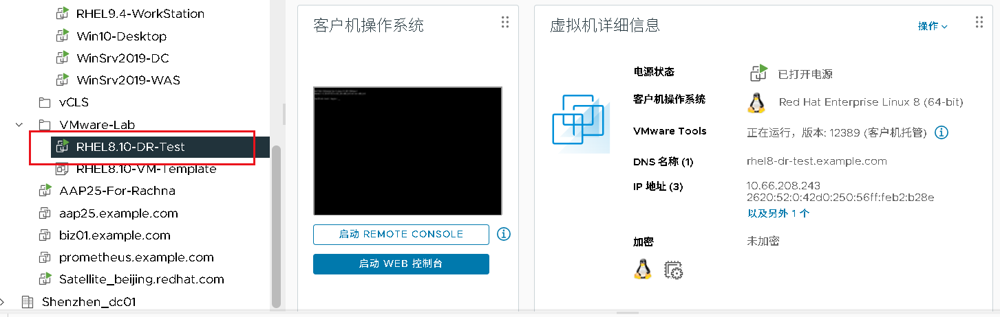
+
2, In vm, make sure vmware-tools and perl installed:
+
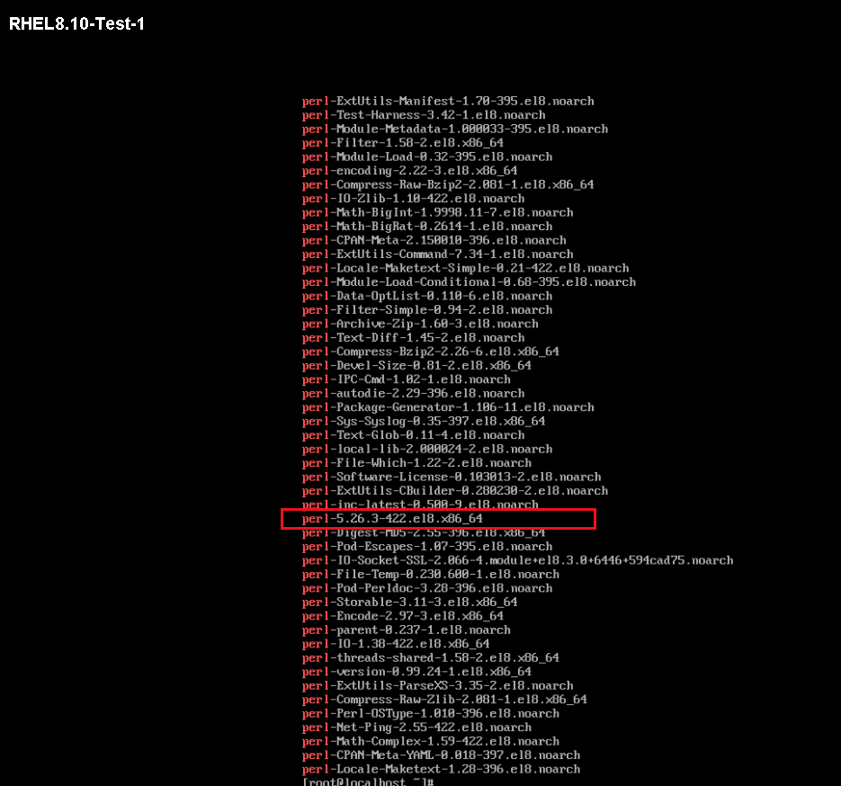
. Based on vCenter admin username and password create credential：
+
In my lab, vCenter IP is 10.71.18.138, admin username and password is：
+
administrator@vsphere.local
+
Your++_++password
+
So create a credential with name “vc++_++credential” and type “VMware vCenter” as following:
+
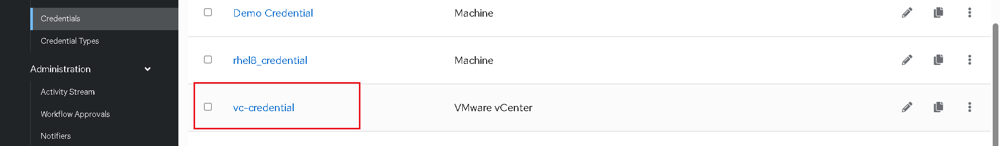
+
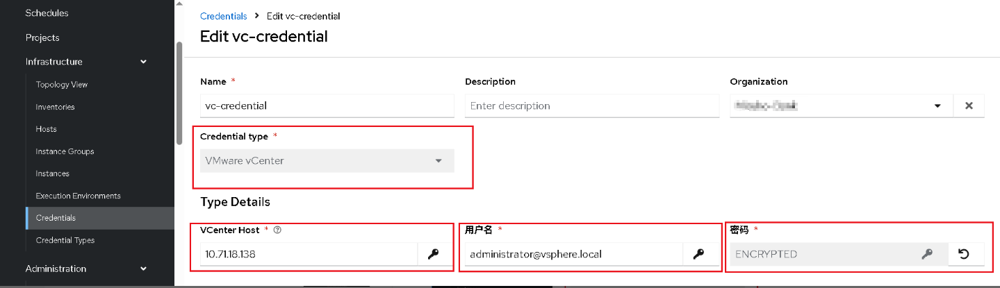
+
Since calling vCenter to execute VMware modules and collections is generally done on AAP, playbook tasks are usually executed locally on AAP via delegate++_++to: localhost or aap. Therefore, there is no need to create an inventory for VMware on the AAP UI.
. Ensure that the AAP controller's project directory contains a complete ansible.cfg file (encapsulated within a custom EE), an inventory file, and a complete collection (for local testing).

++[++admin@aap25-jw example-project++]++$ cat ansible.cfg

++[++defaults++]++

inventory = ./inventory

remote++_++user = admin

++[++privilege++_++escalation++]++

become = true

become++_++method = sudo

become++_++user = root

become++_++ask++_++pass = false

[arabic, start=4]
. Setup notifier on AAP：
+
Create a email notifier on AAP Web UI as example blow:
+
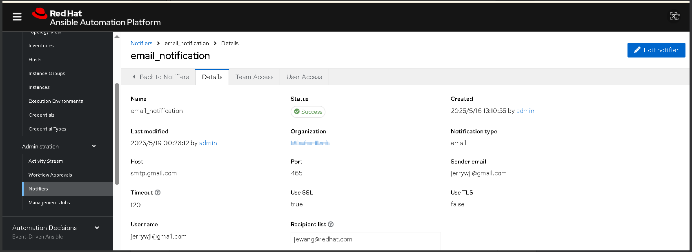

*Steps for create the Automation Workflow：*

[arabic]
. Create the first playbook, linux++_++dr++_++check.yml, content of playbook as below:

++[++admin@aap25-jw example-project++]++$ cat linux++_++dr++_++check.yml

---

- name: VMware Disaster Recovery Info Check

hosts: localhost

gather++_++facts: false

vars:

datacenter++_++primary: ""

datacenter++_++dr: ""

cluster++_++primary: ""

cluster++_++dr: ""

esxi++_++host++_++primary: ""

esxi++_++host++_++dr: ""

target++_++data++_++store: ""

vm++_++name: ""

validate++_++certs: false

mail++_++host: smtp.gmail.com

mail++_++port: 465

mail++_++username: jerrywjl@gmail.com

mail++_++password: YOUR++_++EMAIL++_++PASSWORD

mail++_++to: jewang@redhat.com

tasks:

- name: Check datastore info in DR site

community.vmware.vmware++_++datastore++_++info:

hostname: "++{{++ lookup('env', 'VMWARE++_++HOST') }}"

username: "++{{++ lookup('env', 'VMWARE++_++USER') }}"

password: "++{{++ lookup('env', 'VMWARE++_++PASSWORD') }}"

datacenter: "++{{++ datacenter++_++dr }}"

name: "++{{++ target++_++data++_++store }}"

validate++_++certs: "++{{++ validate++_++certs }}"

delegate++_++to: localhost

register: datastore++_++info

- name: Query content in specified datastore

community.vmware.vsphere++_++file:

hostname: "++{{++ lookup('env', 'VMWARE++_++HOST') }}"

username: "++{{++ lookup('env', 'VMWARE++_++USER') }}"

password: "++{{++ lookup('env', 'VMWARE++_++PASSWORD') }}"

datacenter: "++{{++ datacenter++_++dr }}"

datastore: "++{{++ target++_++data++_++store }}"

path: "++{{++ vm++_++name }}"

state: directory

validate++_++certs: "++{{++ validate++_++certs }}"

delegate++_++to: localhost

register: vm++_++folder++_++check

ignore++_++errors: true

- name: Print datastore info

ansible.builtin.debug:

var: datastore++_++info

- name: Print datastore content list

ansible.builtin.debug:

var: vm++_++folder++_++check

- name: Send DR Check Report via Email

community.general.mail:

host: "++{{++ mail++_++host }}"

port: "++{{++ mail++_++port }}"

username: "++{{++ mail++_++username }}"

password: "++{{++ mail++_++password }}"

to: "++{{++ mail++_++to }}"

subject: "++[++Ansible Report++]++ VMware DR Site Check for ++{{++ vm++_++name }}"

body: ++|++

VMware DR Check Results

=== Datastore Info ===

++{{++ datastore++_++info ++|++ to++_++nice++_++json }}

=== VM Folder Check ===

++{{++ vm++_++folder++_++check ++|++ to++_++nice++_++json }}

delegate++_++to: localhost

Create the first job template with name "VM++_++DR++_++Datastore++_++Check" base on the playbook as below:

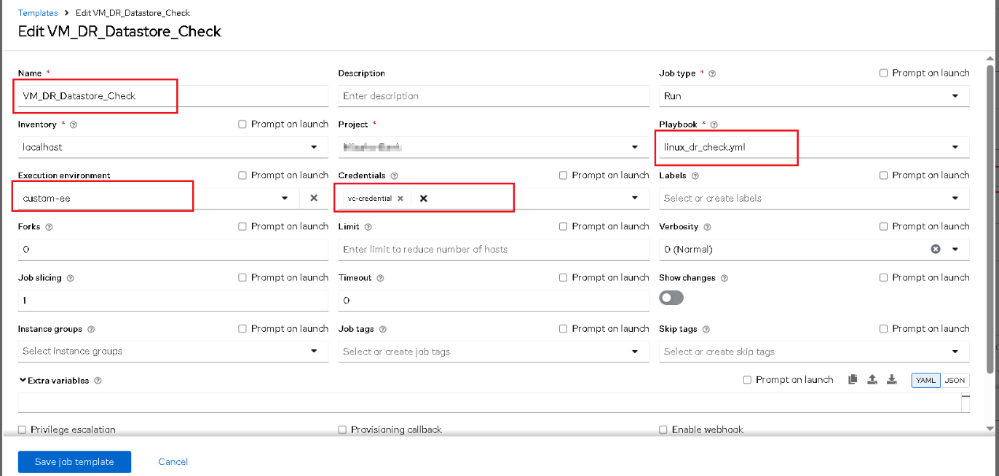

[arabic, start=2]
. Create the second playbook, linux++_++dr.yml, content of playbook as below:

++[++admin@aap25-jw example-project++]++$ cat linux++_++dr.yml

---

- name: VMware Disaster Recovery Failover

hosts: localhost

gather++_++facts: false

vars:

datacenter++_++primary: ""

datacenter++_++dr: ""

cluster++_++primary: ""

cluster++_++dr: ""

esxi++_++host++_++primary: ""

esxi++_++host++_++dr: ""

target++_++data++_++store: ""

vm++_++name: ""

validate++_++certs: false

tasks:

- name: Step 1 - Power off the VM on primary site

community.vmware.vmware++_++guest++_++powerstate:

hostname: "++{{++ lookup('env', 'VMWARE++_++HOST') }}"

username: "++{{++ lookup('env', 'VMWARE++_++USER') }}"

password: "++{{++ lookup('env', 'VMWARE++_++PASSWORD') }}"

validate++_++certs: "++{{++ validate++_++certs }}"

datacenter: "++{{++ datacenter++_++primary }}"

name: "++{{++ vm++_++name }}"

folder: "/vm"

state: powered-off

delegate++_++to: localhost

ignore++_++errors: true

- name: Step 2 - Unregister VM from primary site esxi server

community.vmware.vmware++_++guest++_++register++_++operation:

hostname: "++{{++ lookup('env', 'VMWARE++_++HOST') }}"

username: "++{{++ lookup('env', 'VMWARE++_++USER') }}"

password: "++{{++ lookup('env', 'VMWARE++_++PASSWORD') }}"

validate++_++certs: "++{{++ validate++_++certs }}"

datacenter: "++{{++ datacenter++_++primary }}"

esxi++_++hostname: "++{{++ esxi++_++host++_++primary }}"

folder: "/vm"

name: "++{{++ vm++_++name }}"

state: absent

delegate++_++to: localhost

ignore++_++errors: true

- name: Step 2 - Register VM to dr site esxi server

community.vmware.vmware++_++guest++_++register++_++operation:

hostname: "++{{++ lookup('env', 'VMWARE++_++HOST') }}"

username: "++{{++ lookup('env', 'VMWARE++_++USER') }}"

password: "++{{++ lookup('env', 'VMWARE++_++PASSWORD') }}"

validate++_++certs: "++{{++ validate++_++certs }}"

datacenter: "++{{++ datacenter++_++dr }}"

cluster: "++{{++ cluster++_++dr }}"

folder: "++{{++ datacenter++_++dr }}/vm"

name: "++{{++ vm++_++name }}"

# esxi++_++hostname: "++{{++ esxi++_++host++_++dr }}"

path: "++[{{++ target++_++data++_++store }}++]++ ++{{++ vm++_++name }}/++{{++ vm++_++name }}.vmx"

template: false

state: present

delegate++_++to: localhost

- name: Step 3 - Power on the recovered VM

community.vmware.vmware++_++guest++_++powerstate:

hostname: "++{{++ lookup('env', 'VMWARE++_++HOST') }}"

username: "++{{++ lookup('env', 'VMWARE++_++USER') }}"

password: "++{{++ lookup('env', 'VMWARE++_++PASSWORD') }}"

validate++_++certs: "++{{++ validate++_++certs }}"

datacenter: "++{{++ datacenter++_++dr }}"

name: "++{{++ vm++_++name }}"

folder: "/vm"

state: powered-on

delegate++_++to: localhost

Create the second job template with name "VM++_++DR++_++Operation" base on the playbook as below：

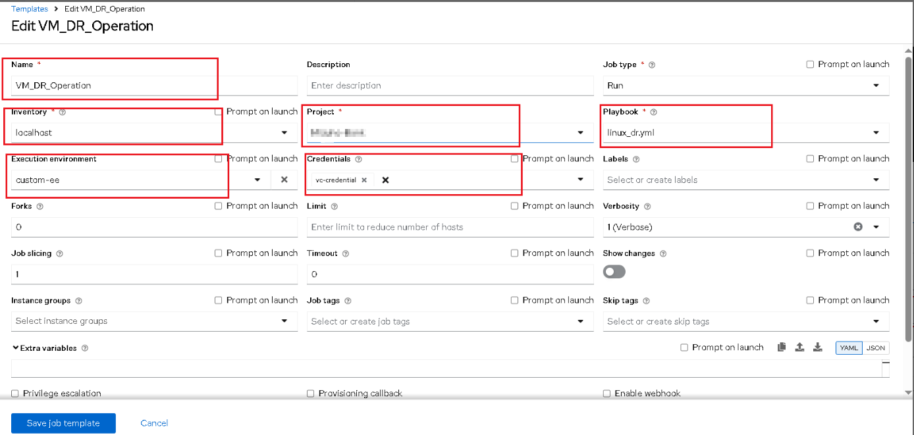

[arabic, start=3]
. Create the third playbook,linux++_++post++_++dr++_++setup++_++vm.yml, content of playbook as below:

++[++admin@aap25-jw mizuho-project++]++$ cat linux++_++post++_++dr++_++setup++_++vm.yml

---

- name: Configure recovered VM network after DR switch

hosts: localhost

become: yes

vars:

datacenter++_++dr: ""

vm++_++name: ""

network++_++interface: ""

vm++_++ip: ""

vm++_++netmask: ""

vm++_++gateway: ""

vm++_++dns:

- ""

- ""

vm++_++root++_++password: cmVkaGF0 # base64 encoded password

pre++_++tasks:

- name: Decode VM root password

ansible.builtin.set++_++fact:

decoded++_++vm++_++root++_++password: "++{{++ vm++_++root++_++password ++|++ b64decode }}"

tasks:

- name: Wait until VMware Tools are running

community.vmware.vmware++_++guest++_++tools++_++wait:

hostname: "++{{++ lookup('env', 'VMWARE++_++HOST') }}"

username: "++{{++ lookup('env', 'VMWARE++_++USER') }}"

password: "++{{++ lookup('env', 'VMWARE++_++PASSWORD') }}"

validate++_++certs: false

datacenter: "++{{++ datacenter++_++dr }}"

name: "++{{++ vm++_++name }}"

timeout: 300

- name: Run command inside a virtual machine with wait and timeout

community.vmware.vmware++_++vm++_++shell:

hostname: "++{{++ lookup('env', 'VMWARE++_++HOST') }}"

username: "++{{++ lookup('env', 'VMWARE++_++USER') }}"

password: "++{{++ lookup('env', 'VMWARE++_++PASSWORD') }}"

validate++_++certs: false

datacenter: "++{{++ datacenter++_++dr }}"

vm++_++id: "++{{++ vm++_++name }}"

vm++_++username: root

vm++_++password: "++{{++ decoded++_++vm++_++root++_++password }}"

vm++_++shell: /usr/bin/nmcli

vm++_++shell++_++args: ++>++

connection modify ++{{++ network++_++interface }}

ipv4.addresses ++{{++ vm++_++ip }}/++{{++ vm++_++netmask }}

ipv4.gateway ++{{++ vm++_++gateway }}

ipv4.dns ++{{++ vm++_++dns ++|++ join(',') }}

ipv4.method manual

connection.autoconnect on

ipv6.method disabled

++>++ /tmp/set++_{{++ network++_++interface }}.txt 2++>++&1

wait++_++for++_++process: true

timeout: 300

register: shell++_++command++_++with++_++wait++_++timeout

- name: Debug nmcli config output

debug:

var: shell++_++command++_++with++_++wait++_++timeout.stdout

- name: Apply and enable network

community.vmware.vmware++_++vm++_++shell:

hostname: "++{{++ lookup('env', 'VMWARE++_++HOST') }}"

username: "++{{++ lookup('env', 'VMWARE++_++USER') }}"

password: "++{{++ lookup('env', 'VMWARE++_++PASSWORD') }}"

validate++_++certs: false

datacenter: "++{{++ datacenter++_++dr }}"

vm++_++id: "++{{++ vm++_++name }}"

vm++_++username: root

vm++_++password: "++{{++ decoded++_++vm++_++root++_++password }}"

vm++_++shell: /usr/bin/nmcli

vm++_++shell++_++args: ++>++

connection up ++{{++ network++_++interface }}

++>++ /tmp/apply++_{{++ network++_++interface }}.txt 2++>++&1

wait++_++for++_++process: true

timeout: 60

register: apply++_++network

- name: Debug nmcli apply output

debug:

var: apply++_++network.stdout

- name: Set vm++_++ip as a fact for workflow usage

ansible.builtin.set++_++stats:

data:

vm++_++ip: "++{{++ vm++_++ip }}"

per++_++host: false

- name: Add deployed VM to inventory

ansible.builtin.add++_++host:

name: "++{{++ vm++_++ip }}"

groups: provisioned

Create the third job template with name "VM++_++DR++_++Post++_++Config++_++VM" base on the playbook as below：

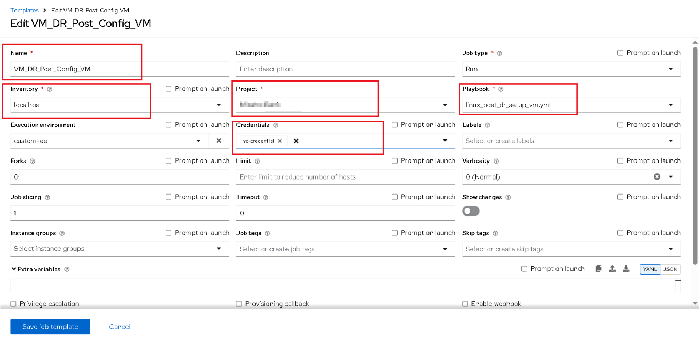

[arabic, start=4]
. Create the forth playbook,linux++_++post++_++dr++_++setup++_++vm.yml, content of playbook as below:

++[++admin@aap25-jw example-project++]++$ cat linux++_++post++_++dr++_++setup++_++app.yml

---

- name: Add dynamic host from previous playbook

hosts: localhost

gather++_++facts: false

tasks:

- name: Add VM to dynamic inventory

ansible.builtin.add++_++host:

name: "++{{++ vm++_++ip }}"

groups: provisioned

- name: Verify VM after DR - update hosts, start httpd, test service

hosts: provisioned

become: yes

tasks:

- name: Set hostname fact

ansible.builtin.set++_++fact:

hostname: "++{{++ ansible++_++hostname }}"

- name: Update existing entry in /etc/hosts with new IP

ansible.builtin.replace:

path: /etc/hosts

regexp: '^++\++d{plus}++\++.++\++d{plus}++\++.++\++d{plus}++\++.++\++d{plus}++\++s{plus}.++*\++b++{{++ hostname }}++\++b'

replace: '++{{++ vm++_++ip }} ++{{++ hostname }}'

backup: yes

- name: Ensure vm++_++ip and hostname are present in /etc/hosts if not matched above

ansible.builtin.lineinfile:

path: /etc/hosts

line: "++{{++ vm++_++ip }} ++{{++ hostname }}"

state: present

create: yes

backup: no

- name: Start httpd service

ansible.builtin.service:

name: httpd

state: started

enabled: yes

- name: Wait for HTTP service on port 80 to be available

ansible.builtin.wait++_++for:

host: "++{{++ vm++_++ip }}"

port: 80

timeout: 30

state: started

- name: Check if httpd is responding on port 80

ansible.builtin.uri:

url: "http://++{{++ vm++_++ip }}"

return++_++content: no

status++_++code: 200

Create the forth job template with name "VM++_++DR++_++Post++_++Config++_++VM" base on the playbook as below：

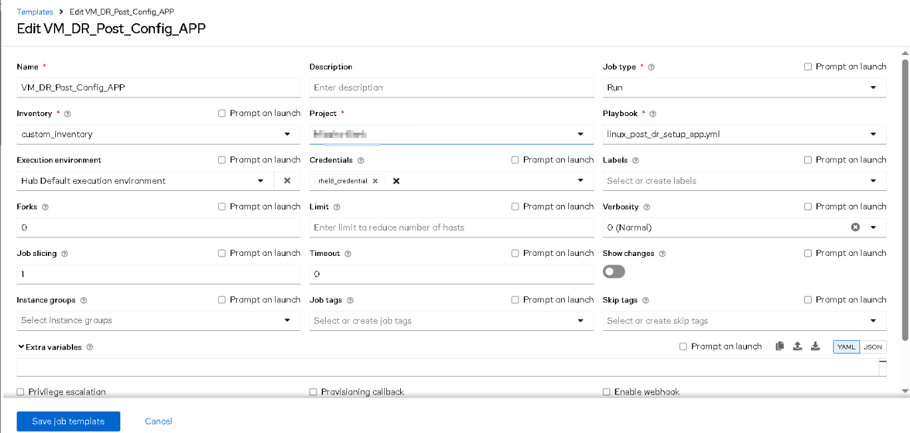

Note:

“custom++_++inventory” is only a place holder without any host, the host IP is as variables forward from previous playbook.

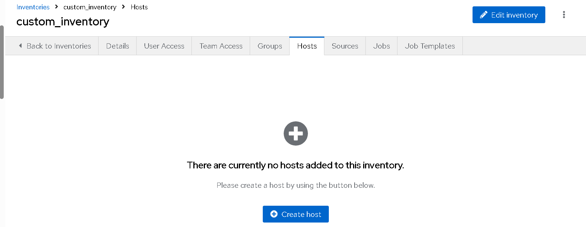

[arabic, start=5]
. Create the workflow job template with name “"Demo2-Linux++_++DR++_++with++_++New++_++Config++_++Setup”, which is consisted of the four Job template just created.
+
On AAP UI the process of workflow job template is as below:
+
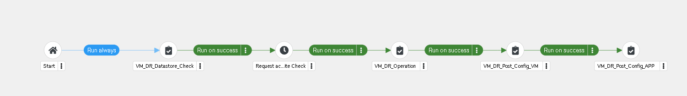

[arabic, start=5]
. Create a couple of survey on the workflow job template as below, based on my Lab env, survey type and content is as below:
+
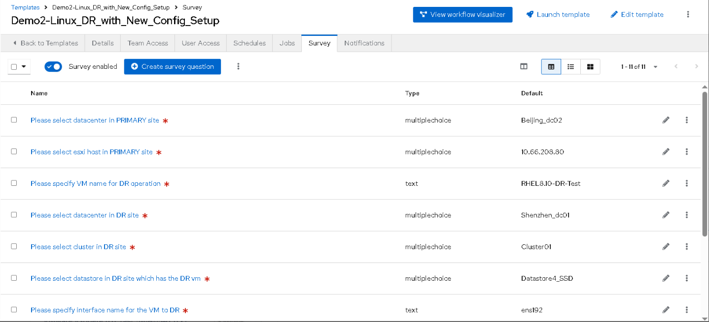
+
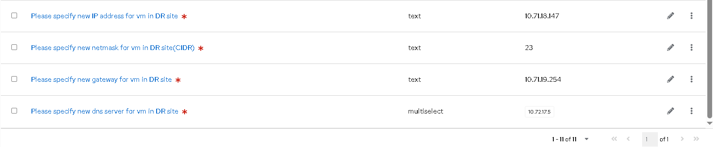
. When launch the workflow, you will need to input variables with survey above.
+
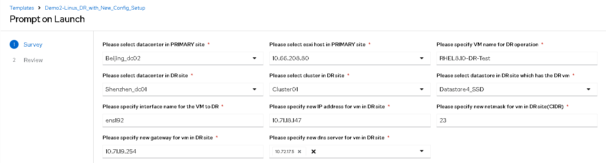
+
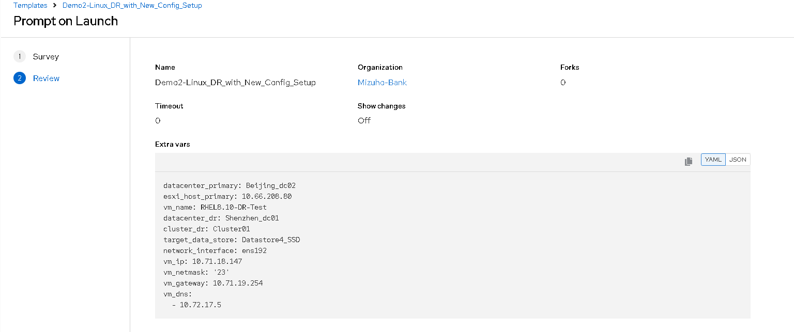
. Let’s add an approval between the first and the second job template as below:
+
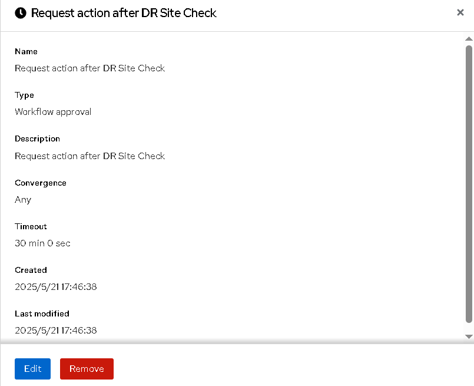
. Enable Email notification on the workflow job template:
+
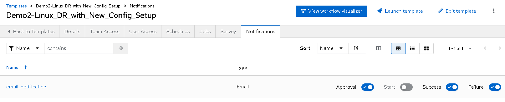

*Steps for testing the workflow：*

The whole workflow need to run about 10-15 mins, when the first job template complete, admin will get Email notification about target data store check on DR site as below:

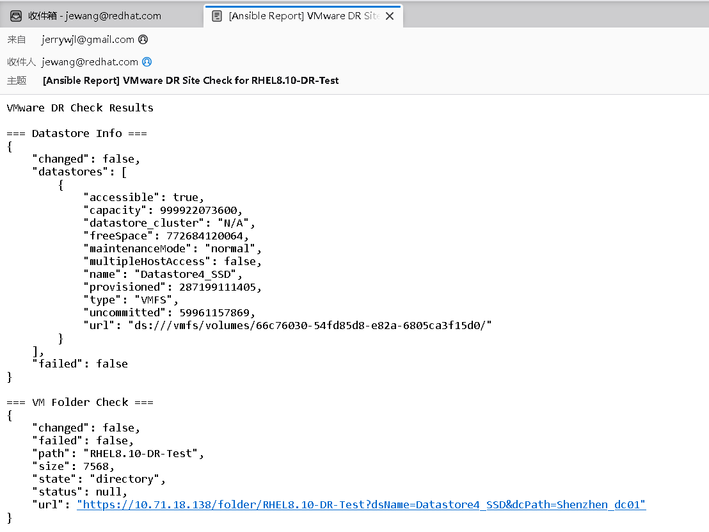

And another email will automatically sent to admin for approval:

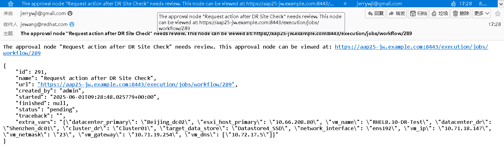

After approval the workflow will complete all job templates one by one.

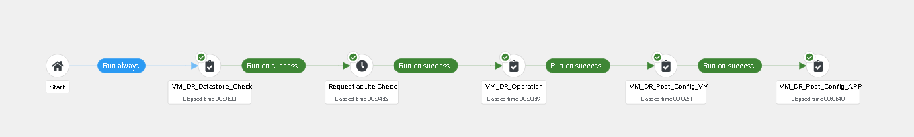

Can see vm is already running on new data center.

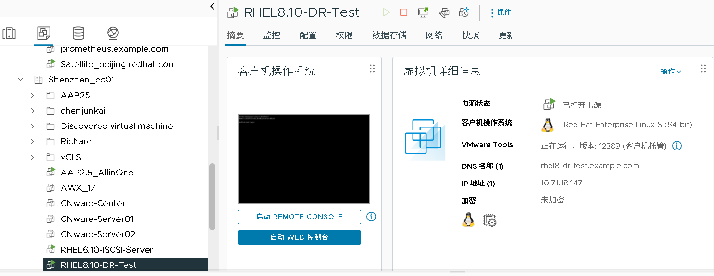

Admin will also get email about the workflow complete successfully.

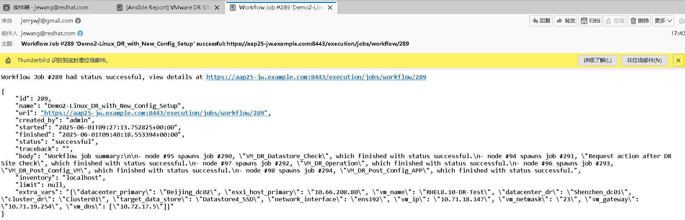
